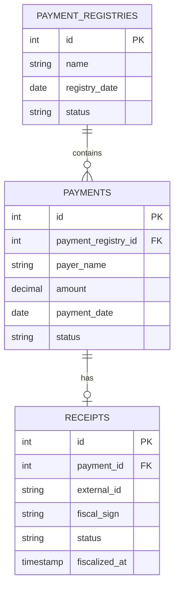

# Лабораторная работа: ORM и миграции (Laravel)

## Цель работы
Освоить работу с данными через ORM, паттерн «Репозиторий» и механизм миграций на примере предметной области ВКР: фискализация реестров платежей с использованием облачной кассы Orange Data.

## Инструменты
PHP, Laravel, Eloquent ORM, миграции Laravel, SQLite, Git.

## Структура проекта
- `app/Models` — модели PaymentRegistry, Payment, Receipt
- `app/Repositories` — PaymentRepository (CRUD и выборка по статусу)
- `app/Console/Commands/TestRepository.php` — тестовая команда
- `database/migrations` — миграции схемы данных

## Схема данных


## Запуск
```
composer install
cp .env.example .env
php artisan key:generate
php artisan migrate
php artisan repo:test
```

## Результаты
Скриншоты выполнения миграций и тестовой команды приложены ниже.